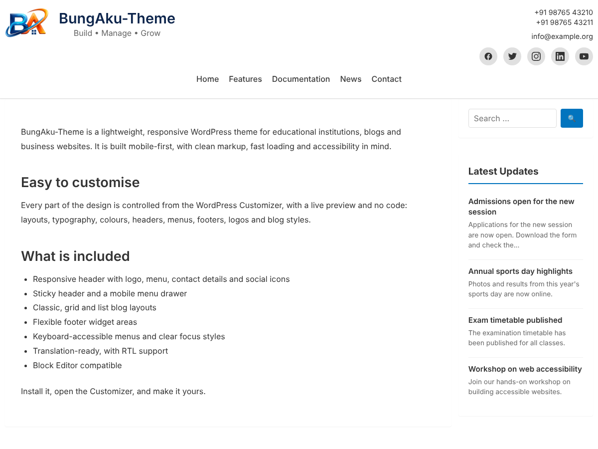

  

# BungAku-Theme

A lightweight, fully responsive WordPress theme for educational institutions, blogs and business websites. Formerly **Mec_Theme**.

## Features

- Responsive design with a mobile menu drawer and an in-menu search bar.
- Customizer-powered with live preview: colours, typography per device (desktop, tablet, mobile), header, menu, layout, footer and blog options.
- Blog layouts: classic, grid (up to 4 columns) and list.
- Sticky header, custom logo with position control, and contact details with social icons in the header.
- Footer widget areas in 1 to 4 columns, horizontal or vertical.
- Author bio, related posts, and a Recent Posts widget with thumbnail, excerpt and Read More link.
- Accessibility: ARIA attributes, keyboard navigation, focus management and a skip-to-content link.
- Translation-ready (`.pot` included) with RTL support.
- Block Editor support: custom colour palette and font sizes.
- Built-in update checker that reads this repository's releases.

## Requirements

WordPress 5.0 or later (tested up to 7.1). License: GPL v2 or later.

## Installation

1. Download `bungaku-theme-vX.Y.Z.zip` from the [latest release](https://github.com/bungakku/BungAku-Theme/releases/latest). Use the zip listed under **Assets**, not GitHub's "Source code" archives.
2. In WordPress go to **Appearance > Themes > Add Theme > Upload Theme**, choose the zip, then install and activate it.
3. Go to **Appearance > Customize** to set it up (Layout, Blog, Colors, Typography, Contact & Social).

## Updates

The theme checks this repository's releases (cached for 12 hours) and shows new versions under **Dashboard > Updates**. "Check again" there forces a new check.

## Coming from Mec_Theme

BungAku-Theme is Mec_Theme renamed (v1.7.99 changed names only, no behaviour). WordPress stores Customizer settings and widgets per theme folder, so a site that switches starts with default settings:

1. Install `bungaku-theme` as a new theme and re-enter your settings.
2. Delete `mec_theme`.

Do not use "Update now" on an installed `mec_theme`: it would put the new package into the `mec_theme` folder. Old Mec_Theme releases stay on the [Releases](https://github.com/bungakku/BungAku-Theme/releases) page, and the old repository URL redirects here.

## Plugin compatibility

The theme includes compatibility styles for the Online Admission Manager plugin's application form.

## Changelog

See [CHANGELOG.md](CHANGELOG.md).

## Author and license

By [Biswajit Thokchom](https://github.com/bungakku). Licensed under the [GNU GPL v2 or later](https://www.gnu.org/licenses/gpl-2.0.html).
